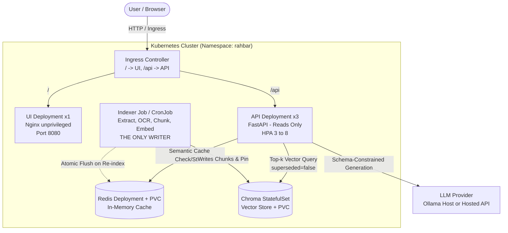

# RAHBAR: Grounded Question-Answering Service on Kubernetes

[](https://github.com/sarim751/rahbar/actions/workflows/ci.yml)
[](https://github.com/sarim751/rahbar/actions/workflows/cd.yml)
[](https://kubernetes.io/)
[](https://fastapi.tiangolo.com/)

RAHBAR is a fault-tolerant, grounded question-answering system deployed on a Kubernetes cluster that answers student and administrative queries strictly from a verified document corpus, cites every retrieved source, refuses hallucinated answers, and survives pod failures, rolling updates, and cluster reboots.

---

## Architecture Overview

RAHBAR enforces a strict separation of concerns between data producers and consumers: an **Indexer Job** that is the sole writer to ChromaDB, and an **API Deployment** that only reads from the vector store on every query.



---

## API Specification

The service exposes schema-constrained REST endpoints:

| Method | Endpoint | Description | Guardrails & Contracts |
| :--- | :--- | :--- | :--- |
| GET | `/healthz` | Liveness probe | Returns 200 OK if process is alive; touches zero downstream dependencies to prevent restart storms. |
| GET | `/readyz` | Readiness probe | Returns 200 OK only if Chroma is reachable, collection is non-empty, Redis is reachable, and `EMBED_MODEL` pin matches collection metadata (HTTP 503 otherwise). |
| GET | `/metrics` | Prometheus metrics | Exposes request count, latency histogram, retrieval scores, cache hit ratios, and abstention counters. |
| POST | `/api/ask` | Grounded question endpoint | Takes `{"question": "..."}` (3 to 500 characters); validates output against Pydantic `Answer` schema; enforces relevance floor and citation matching. |

---

## Cluster Setup and Deployment Instructions

### 1. Prerequisites
- Docker Desktop or Docker CE with WSL 2 integration enabled.
- Minikube (`>= 1.32.0`) and `kubectl`.
- Ollama running locally with `llama3.2:3b` and `nomic-embed-text`.

### 2. Start Minikube with Calico CNI
Calico CNI is mandatory to enforce `NetworkPolicy` rules:
```bash
minikube start --driver=docker --cni=calico --memory=6144 --cpus=4
minikube addons enable metrics-server
minikube addons enable ingress
```

### 3. Build Container Images
Build the container images and load them directly into Minikube's image cache:
```bash
docker build -t rahbar-api:latest api/
docker build -t rahbar-indexer:latest indexer/
docker build -t rahbar-ui:latest ui/

minikube image load rahbar-api:latest
minikube image load rahbar-indexer:latest
minikube image load rahbar-ui:latest
```

### 4. Create Kubernetes Secrets
Secrets are created via the CLI and never committed to version control:
```bash
kubectl create namespace rahbar
kubectl create secret generic rahbar-secret -n rahbar --from-literal=LLM_API_KEY="${LLM_API_KEY:-placeholder}"
```

### 5. Exact Manifest Apply Order
Apply the manifests in the exact documented order using Kustomize:
```bash
# Apply full base configuration
kubectl apply -k k8s/overlays/dev

# Wait for database tiers to become ready
kubectl rollout status statefulset/chroma -n rahbar --timeout=120s
kubectl rollout status deployment/redis -n rahbar --timeout=120s
```

---

## How to Run the Indexer

Indexing runs on demand via a Kubernetes Job, completely decoupled from API startup:
```bash
# Trigger an immediate indexing Job
kubectl create job --from=cronjob/reindex manual-indexer-run-1 -n rahbar

# Monitor Job execution
kubectl wait --for=condition=complete job/manual-indexer-run-1 -n rahbar --timeout=300s
kubectl logs -l app=indexer -n rahbar --tail=50
```

Once indexing finishes, the API deployment readiness probes pass and the pods begin serving user traffic:
```bash
kubectl rollout status deployment/api -n rahbar --timeout=120s
```

---

## Verification & Smoke Test

Access the chat UI through the Ingress or via port-forward:
```bash
kubectl port-forward svc/ui 8080:8080 -n rahbar
```
Navigate to `http://localhost:8080` in your browser, or submit a question directly via curl:
```bash
curl -X POST http://localhost:8080/api/ask \
     -H "Content-Type: application/json" \
     -d '{"question": "What CGPA is required to avoid probation?"}'
```
